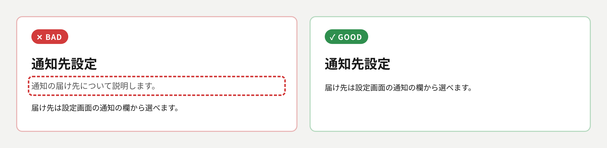
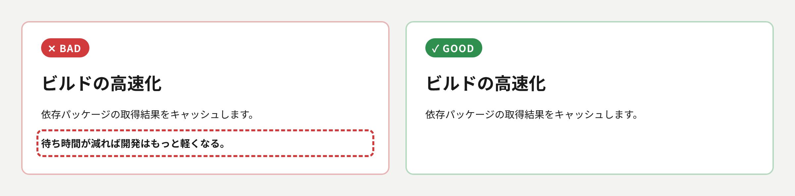
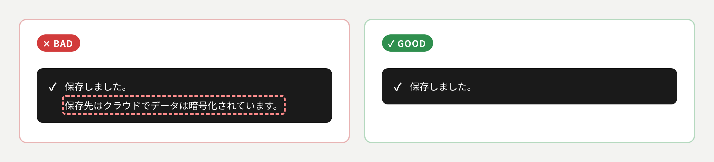
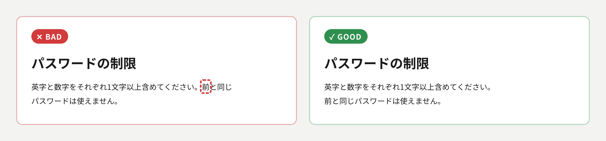
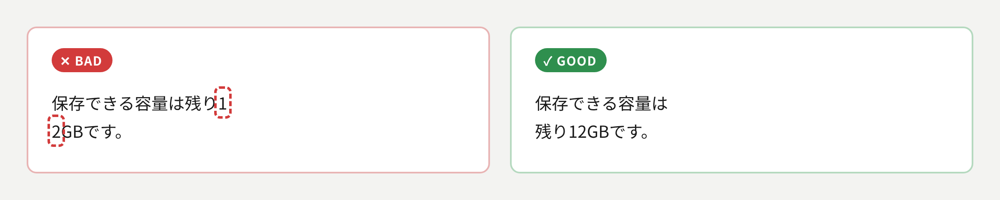
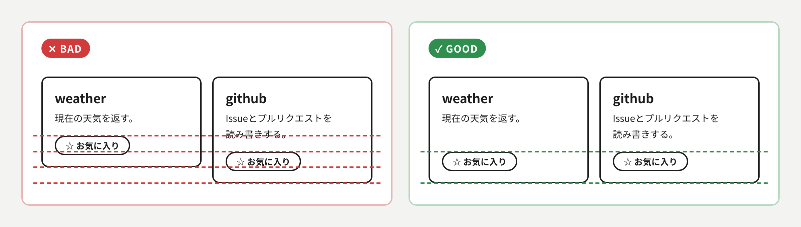

# UI原則

## このスキルの目的

AIが作るUIには、要らない文を足す癖と、揃いや折り返しの崩れに気づきにくい癖があるため、どのデザインスタイルで作る場合でも避ける作りをここに集める。

## あるべき状態

### 見出しの直後に、情報を足さない補足を置かない

同じことを2度読ませると、どちらが主か分からなくなるため、見出しの直後には、見出しを言い換えた補足やリード文ではなく、本文・図・具体例を直接続ける。

### 要点を言い換えた締めのひとことを書かない

新しい情報がないまま、もう1つの主張のように見えて目を分散させるため、節やスライドの最後に、述べた要点を格言風に言い換えた1文を置かない。

### 目的に使わない情報を添えない

何が要点かを読み分ける負荷が増えるため、その画面で読み手が知るべき本質的な情報以外は、関連していても書かない。
補足や任意の情報は、折り畳みや注釈として別の箇所に書く。

### 見出しは項目名にする

要点を言い切る文の見出しはAIが書いたと分かる型になるため、見出しは文にせず、「通知先設定」「パスワードの制限」のように、その節が何を扱うかを示す名詞句にする。
要点は見出しではなく本文に書く。
「〜について」「〜の話」のように中身を示さない言い方は避ける。

### 本文の段落では、1文ごとに改行する

文が行の途中から始まると、文の区切りを目で追えないため、本文の段落では句点の直後で改行し、次の文を行頭から始める。

### 不自然な位置で折り返さない

意味の切れ目で止まれず読みにくくなるため、1〜2文字だけの行を作らず、語、数値と単位、括弧の内側の途中で改行しない。
日本語は文節の切れ目で改行させ（CSSなら`word-break: auto-phrase`）、狭い幅と広い幅の両方で確かめる。

### 横に並ぶ要素の端と、中の要素の高さを揃える

同じ高さに違う役割の要素が並ぶと、見比べにくく、押す場所も探すことになるため、横に並べた箱やカードは上端と下端を揃え、中のボタンなど同じ役割の要素も同じ高さに置く。
中身の量が違うときは、説明文など量が変わる要素の下を余白にして、末尾の要素を下端に揃える。

