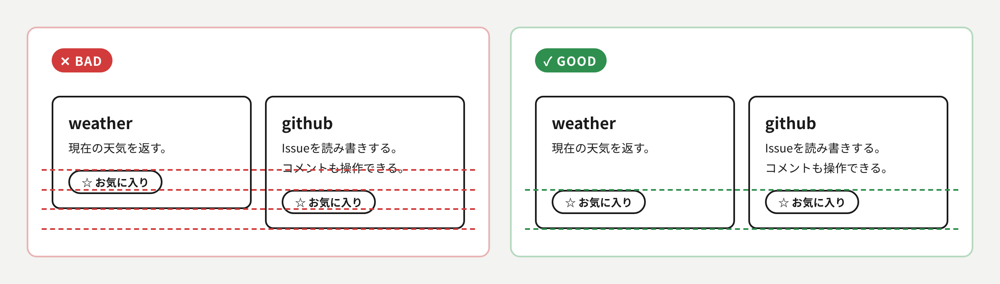
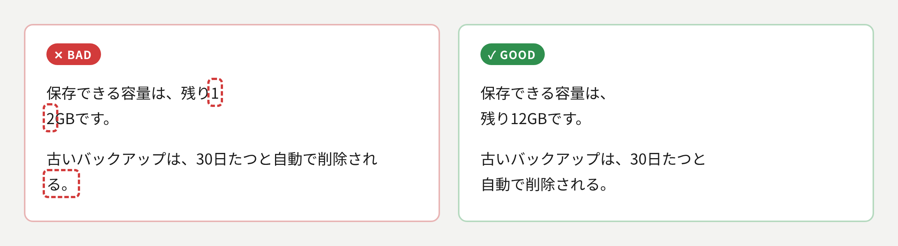
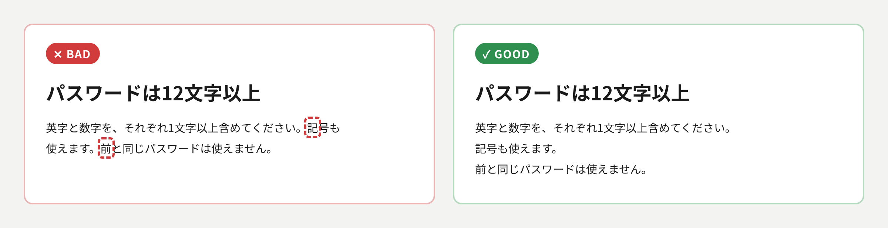
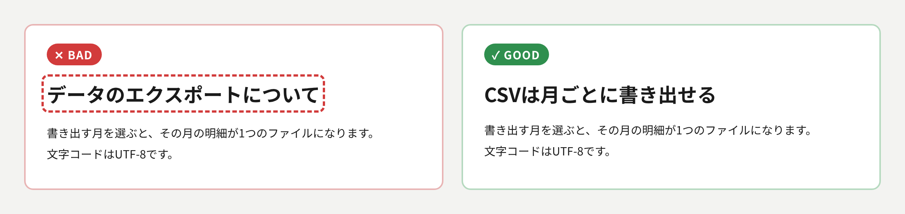

# UI原則

## このスキルの目的

AIが作るUIには、情報を増やさずに文字だけを増やす癖と、揃いや折り返しの崩れに気づきにくい癖がある。
どのデザインスタイルで作る場合でも避ける作りをここに集める。
各項目の画像は、左がBAD、右がGOODで、違いを赤や緑の印で示す。

## あるべき状態

### 見出しの直後に、情報を足さない補足を置かない

見出しの直後には、見出しを言い換えた補足やリード文ではなく、本文・図・具体例を直接続ける。
同じことを2度読ませると、どちらが主か分からなくなるためである。
補足の枠を持つデザインでも、見出しにない情報がなければ枠ごと省く。

### 要点を言い換えた締めのひとことを書かない

節やスライドの最後に、述べた要点を格言風に言い換えた1文を置かない。
新しい情報がないまま、もう1つの主張のように見えて目を分散させるためである。
締めに置く文は、次の行動や参照先など、まだ書いていない情報を持つものに限る。

### 横に並ぶ要素の端と、中の要素の高さを揃える

横に並べた箱やカードは、上端と下端を揃え、カードの中でも同じ役割の要素（ボタンなど）を同じ高さに置く。
同じ高さに違う役割の要素が並ぶと、見比べにくく、押す場所も探すことになるためである。
中身の量が違うときは、説明文などの量が変わる要素の下を余白にして、ボタンなど末尾の要素を下端に揃える。

### 不自然な位置で折り返さない

1〜2文字だけの行を作らず、語、数値と単位、括弧の内側の途中で改行しない。
読み手が意味の切れ目で止まれず、組みの質が低く見えるためである。
日本語は文節の切れ目で改行させ（CSSなら`word-break: auto-phrase`）、狭い幅と広い幅の両方で確かめる。

### 本文の段落では、1文ごとに改行する

本文の段落では、句点の直後で改行し、次の文を行頭から始める。
文が行の途中から始まると、文の区切りを目で追えないためである。

### 見出しは事実を言い切る

見出しは、手順のラベルや「〜について」ではなく、その節の要点を言い切る文にする。
見出しだけを拾い読みしても、内容が伝わるようにするためである。

