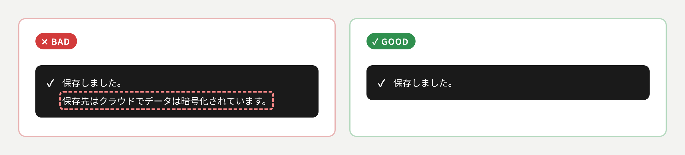
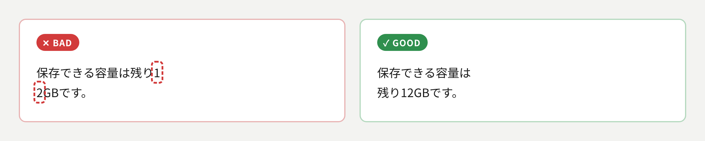
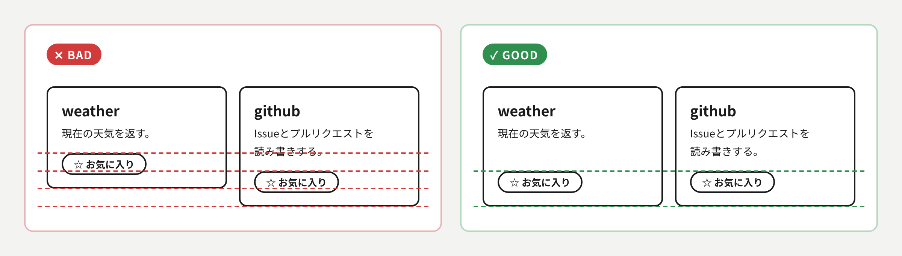
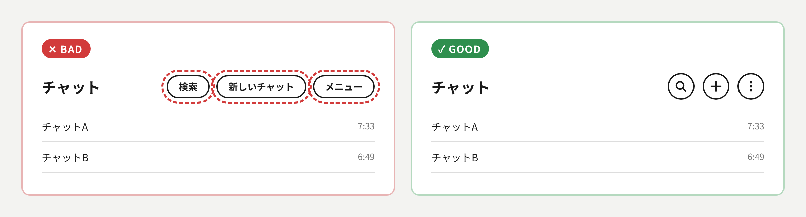

# UI原則

## 目的
AIが生成しがちな「不要な文章の追加」と「レイアウトの崩れ（揃え・折り返し）」を防ぎ、人間にとって読みやすく整ったUIを作成する。

## テキストの原則

### 1. 見出し直後の不要なリード文を省く
見出しを単に言い換えただけの導入文は置かず、見出しの直後に本文・図・具体例を直接配置する。

### 2. 末尾のまとめ・締めの一文を省く
セクションやスライドの末尾に、既出の内容を言い換えただけの総括や格言風の文を置かない。

### 3. 主目的に不要な情報を削る
その画面の目的を果たすために不可欠な情報だけを載せる。関連していても優先度の低い補足や任意の情報は、折りたたみ（アコーディオン）や注釈に逃がす。

### 4. 見出しは文章ではなく「名詞句（項目名）」にする
見出しで主張を言い切る文章は避け、内容を示す名詞句にする（例:「〜の設定」「パスワード制限」）。
- 主張や要点は本文に書く。
- 「〜について」「〜の話」といった具体性のない表現は避ける。

### 5. 本文は1文ごとに改行する
文の区切りを明確にするため句点（。）の直後で改行し次の文は行頭から始める。

### 6. 読点は100字あたり1つ以下にする
読点が多い文はAIが書いたと分かる型になるため、読点は本文の100字あたり1つ以下にする。
判定は読点の数を文字数で割るだけで行い並列や長い主語の後も例外にしない。
超えるときは読点で節をつなぐのをやめて文を分ける。
`scripts/ten-density.ts`で測る。

### 7. 1つの事柄は1か所で言い切る
1つの事柄について書いた後に言い換えや新しい情報のない補足を重ねない。
条件や例外も同じ文で言い切り後に続く文・括弧・注釈で内容を覆さない。

### 8. 利用者の目線で用語を選ぶ
作り手の側の用語ではなく画面を使う人が普段使う言葉で書く。

## レイアウトの原則

### 9. 意味の通じる位置で改行・折り返す
単語の途中・数値と単位の間・括弧の内側などで不自然に折り返さない。また行末に1〜2文字だけが余る状態を避ける。
- 日本語は文節で改行する（Web実装時は `word-break: auto-phrase` 等を検討）。
- 画面幅の広狭どちらでも崩れないことを確認する。

### 10. 並列する要素の配置と高さを揃える
横に並べるカードやブロックは上下の端を揃える。内部にあるボタンなどの同種要素も、水平方向の高さを統一する。
- 中身のテキスト量が異なる場合は余白で高さを調整し、最下部の要素（ボタン等）のラインを揃える。

## 操作の原則

### 11. 意味の定まった操作はアイコンで示す
新規作成・検索・閉じる・メニューのように記号だけで意味が通じる操作は文字のボタンにせずアイコンボタンにする。
- アイコンだけでは意味が伝わらない操作は文字で書く。
- 読み上げ用の名前を`aria-label`などで付ける。

