# UI原則

## 目的
AIが生成しがちな「不要な文章の追加」と「レイアウトの崩れ（揃え・折り返し）」を防ぎ、人間にとって読みやすく整ったUIを作成する。

## テキストの原則

### 1. 見出しや項目名の直後で言い換えない
本文・図・具体例から始め説明を添えるときは見出しにないことだけを書く。

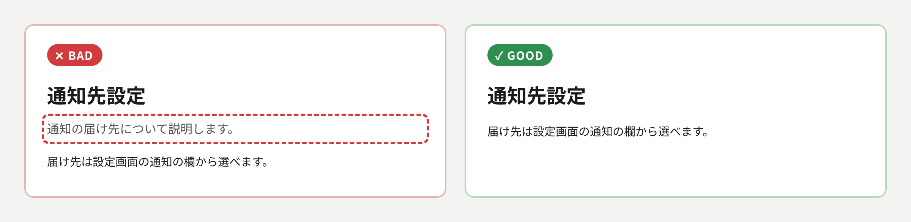

### 2. 末尾のまとめ・締めの一文を省く
既出の内容を言い換えた総括や格言風の文がこれに当たる。

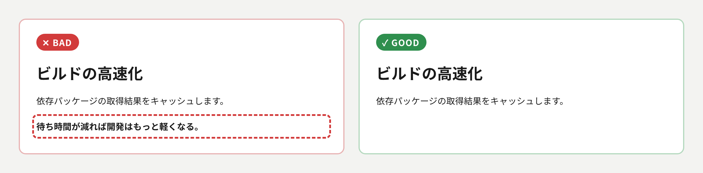

### 3. 主目的に不要な情報を削る
関連していても優先度の低い補足や任意の情報は折りたたみや注釈に逃がす。

### 4. 見出しや項目名はひとことで書く
文にせず具体的な名詞で書き主張や要点は本文に回す。
- 例：「通知の設定」
- 避ける例：「〜について」「〜の話」

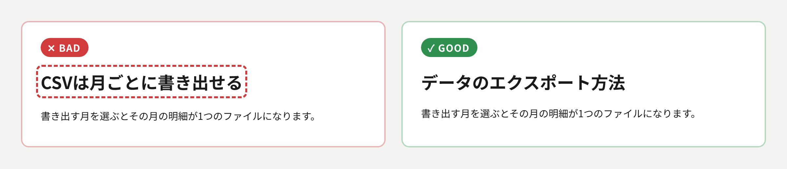

### 5. 本文は1文ごとに改行する
句点の直後で改行して文の区切りを見やすくする。

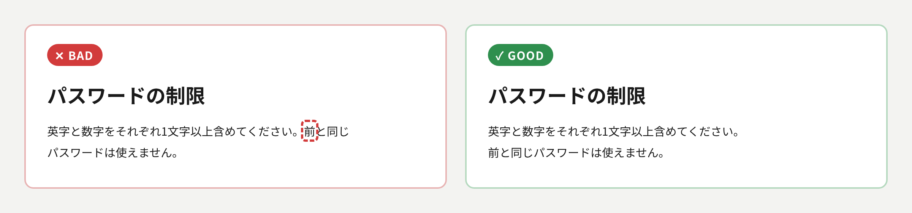

### 6. 読点は100字あたり1つ以下にする
読点の数を本文の文字数で割るだけで判定し並列や長い主語の後も例外にせず`scripts/ten-density.ts`で測る。
超えるときは読点で節をつながず文を分ける。

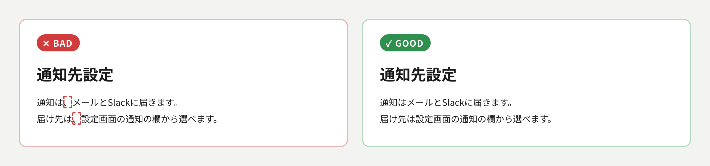

### 7. 1つの事柄は1か所で言い切る
言い換えや新しい情報のない補足を重ねず条件や例外も同じ文に入れる。
- 避ける例：後に続く文・括弧・注釈で条件を足したり打ち消したりする。

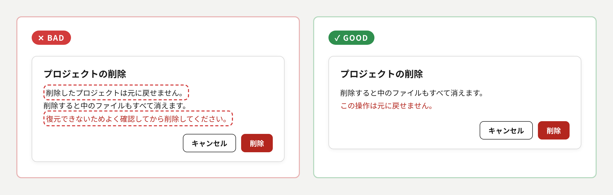

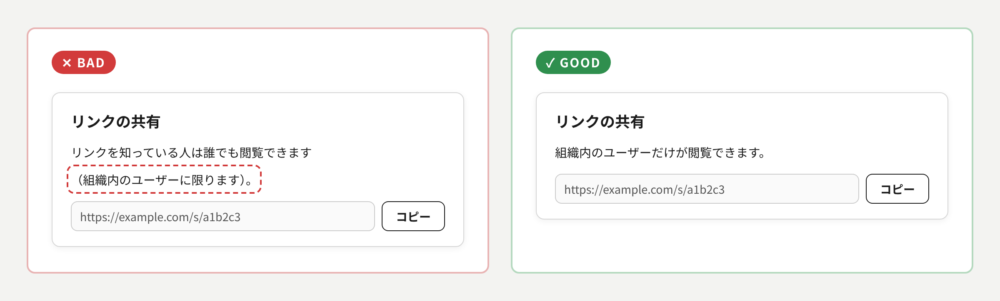

### 8. 利用者の目線で用語を選ぶ
作り手の側の用語ではなく画面を使う人が普段使う言葉で書く。

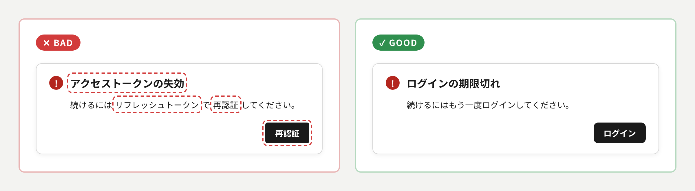

## レイアウトの原則

### 9. 意味の通じる位置で改行・折り返す
Webでは`word-break: auto-phrase`で文節ごとに折り返し行末に1〜2文字だけを残さない。
画面幅が変わっても崩れないことを確かめる。
- 避ける例：単語の途中・数値と単位の間・括弧の内側での折り返し

### 10. 並列する要素の配置と高さを揃える
カードの上下の端と中のボタンの高さを揃え中身の量の差は余白で吸収する。

### 11. 関連の近いものをまとめて並べる
文字とアイコンは同じまとまりに混ぜずまとまりの間をはっきり区切る。
- 例：ヘッダーはサイト名・文字のリンク・アイコン群に分けアイコンは検索・テーマ・通知・アカウントの順に置く。

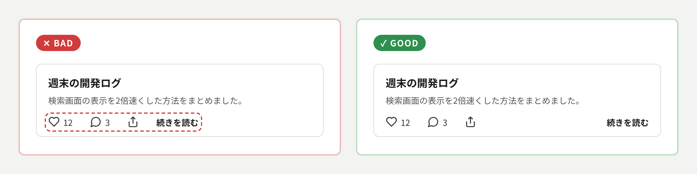

## 操作の原則

### 12. 意味の定まった操作はアイコンで示す
意味が伝わらない操作は文字で書きアイコンには`aria-label`で読み上げの名前を付ける。
ヘッダーやツールバーのようなボタン要素だと分かる場所では枠で囲まず押せる範囲を余白で確保する。
枠を付けるときもアイコン自体の円や四角と重ねて二重にしない。

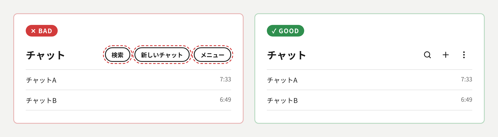

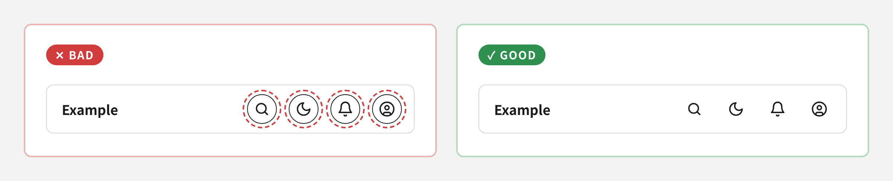
